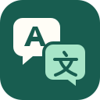

<p align="center"></p>
<h1 align="center">双语翻译器</h1>
<p align="center">新闻网页与 YouTube，中英对照阅读。</p>

精简的 Chrome 扩展与本机助手，使用你自己的 ChatGPT 或 Google Antigravity 账号。项目独立开发，与 OpenAI、Google、WSJ、Reuters、YouTube 均无隶属或官方背书关系。

> **当前为 0.5.1 测试版。安装包已在 Apple 芯片 Mac + Chrome 上验证；Windows、Intel Mac 尚未验收。需要先安装本机助手，单独加载扩展不能完成翻译。Chrome 应用商店尚未发布。**

## 功能

- WSJ、Reuters 新闻正文及新闻首页：英文下方插入中文，保留原文与链接；不绕过付费墙。
- YouTube：为有英文字幕的视频显示双语字幕，按播放位置预取；支持跳转、缓存、全屏字号跟随。
- 字幕字号滑块、拖动角点调整大小、Option＋E 快捷翻译。
- ChatGPT / Antigravity 来源切换，各自保留模型偏好。
- 当前页与今日 Token 统计；官方值缺失时使用明确标注的估算。显示提供方实际开放的额度窗口，不承诺统一订阅余额。
- 断线恢复、有限次数重试、本机译文缓存、停止并恢复原文。

不包含聊天侧栏、背单词、OCR、无字幕音频识别或视频下载功能。不同网站布局、受限视频、直播和 Shorts 可能不支持。

## 安装（Apple 芯片 Mac）

1. 从 [Releases](https://github.com/a719386471-stack/bilingual-translator/releases) 下载最新版 `bilingual-translator-版本号-macos-arm64.zip` 并解压。
2. 双击 **安装与修复.command**。包内包含经 SHA-256 校验的独立 Python 和锁定版本依赖；无需 Homebrew、Xcode 或手动安装 Python。
3. 按安装完成页提示，在 Chrome 开发者模式加载助手指定的 `extension` 文件夹。不要重复加载解压包里的副本。
4. 打开扩展 → **账号与设置**，登录自己的 ChatGPT 或 Antigravity。ChatGPT 通道需要本机安装并登录官方 Codex/ChatGPT 组件；Antigravity 可通过包内 **安装Antigravity.command** 获取官方 ACP 组件，再本人完成 Google 登录。
5. 打开英文新闻或带英文字幕的 YouTube 视频，按 **Option＋E**。

助手按需启动，不设置开机自启。面板中的 **翻译服务** 开关可停止服务。**重新连接**修复本机配对，**检查安装**查看环境；再次运行安装器可保留数据修复。

这是未签名公证的测试安装包，目前未上架 Chrome 商店。若系统阻止打开，请先核对发布来源及文件摘要，依照系统正常的用户确认流程处理；不要关闭系统安全保护。公司受管浏览器可能禁止开发者模式或 Native Messaging。

## 账号与额度隔离

**每位使用者登录自己的账号，消耗自己的使用量。** 仓库、扩展包、安装包不包含开发者的登录令牌、API Key、连接码、账号配置或翻译缓存，也没有连接开发者电脑或共享翻译服务器的地址。

本机助手只监听 `127.0.0.1`，通过每次本机安装生成的随机连接码与扩展通信。Native Messaging 仅允许已注册的明确扩展编号；公开的扩展公钥只用于保持编号，不是登录凭证。

ChatGPT 通道使用使用者本机官方组件管理的登录；不会自动使用环境中的 OpenAI API Key。Antigravity 使用该使用者电脑上的独立登录配置。同一操作系统用户会复用其本机已有的官方组件登录；不要向他人复制 Application Support 下的账号数据或共享已登录的电脑会话。

订阅和模型是否可用由提供方决定。Token 估算不能用作账单，ChatGPT 的本机 Codex 额度窗口也不代表整个 ChatGPT 订阅的统一余额。

## 数据与隐私

点击翻译或使用快捷键后，当前页面的英文文本、标题或字幕会经本机助手发送到你选择的 OpenAI / Google 服务；YouTube 原始字幕读取可能向 YouTube 请求该视频的公开字幕。缓存、偏好和用量记录保存在本机。开发者没有接收这些内容的服务器，不添加分析追踪。

详细说明：[隐私政策](PRIVACY.md)、[安全说明](SECURITY.md)、[第三方组件](THIRD_PARTY_NOTICES.md)。

卸载后台可运行 **卸载后台（保留可恢复备份）.command**，程序与账号数据移至可恢复备份，再在 Chrome 中移除扩展。清缓存和卸载的范围详见隐私政策。

## 开发与测试

源码入口为 `extension/` 与 `helper.py`，本机连接由 `native_host.py` 实现。使用 Python 3.12 及锁定依赖进行验证：

```sh
python3 -m venv .venv
.venv/bin/python -m pip install -r requirements-lock.txt
.venv/bin/python -m unittest discover -s tests -p 'test_*.py'
```

浏览器测试另需 `requirements-dev.txt` 与 Playwright Chromium；`tests/browser_smoke.py`、`tests/sites_smoke.py`、`tests/recovery_smoke.py` 使用隔离配置与模拟翻译，不消耗真实账号额度。`tests/distribution_smoke.py` 面向完整离线安装包，在隔离数据目录验证首次安装、Native Messaging、修复、目录移动和可恢复卸载。

```sh
python build_release.py --assets /path/to/verified-distribution-assets
python build_publication.py --out /path/to/publication-output
```

`build_release.py` 只收集明确列出的程序文件，不打包运行中的账号目录。`build_publication.py` 生成经过筛选的源码快照与 Chrome 商店专用扩展 ZIP；商店 ZIP 不包含本机助手。首次上传商店得到正式扩展编号后，仍须把该编号及对应公钥同步至安装器并重建发布包，才能让商店版本与助手配对。

## 许可

本项目源码及原创 logo 使用 [MIT 许可](LICENSE)。第三方组件遵守各自许可；ChatGPT、Antigravity 等官方组件不包含在项目源码中，仍须遵守提供方的账号、地区和使用条款。
